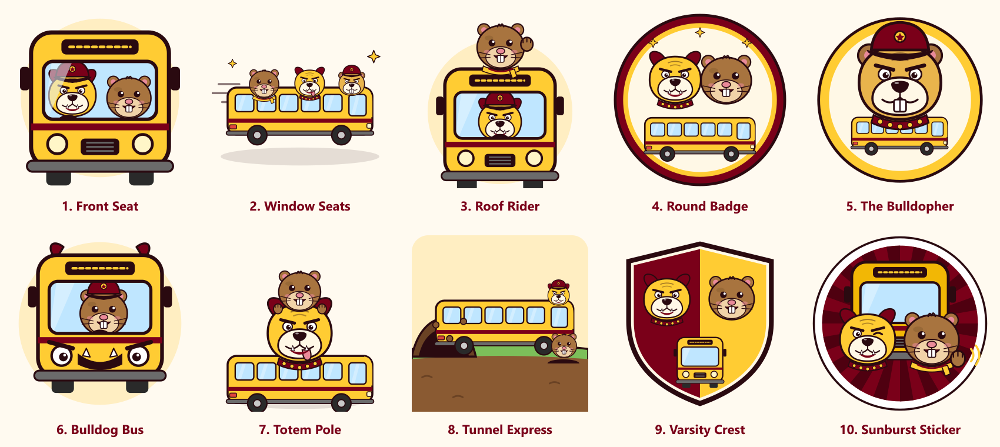

# Mascot options

Original cartoon artwork (bulldog + gopher + bus), drawn as SVG for Bulldog Shuttle. Not based on any existing logo or character.

1. **Front Seat** (`01-front-seat.svg`): Bulldog drives, gopher rides shotgun, seen through the windshield.
2. **Window Seats** (`02-window-seats.svg`): Side-view coach with the crew leaning out the windows, speeding along.
3. **Roof Rider** (`03-roof-rider.svg`): Bulldog at the wheel; gopher waving from the roof.
4. **Round Badge** (`04-round-badge.svg`): Circular emblem: two heads over a bus, ready for a favicon.
5. **The Bulldopher** (`05-bulldopher.svg`): One hybrid critter: bulldog face, gopher ears and buck teeth, driver cap.
6. **Bulldog Bus** (`06-bulldog-bus.svg`): The bus itself is the bulldog (headlight eyes, toothy grille); gopher drives.
7. **Totem Pole** (`07-totem.svg`): Gopher atop bulldog atop the bus. Teamwork.
8. **Tunnel Express** (`08-tunnel-express.svg`): Bus bursts out of a gopher burrow; gopher pops up, bulldog drives.
9. **Varsity Crest** (`09-crest.svg`): Split maroon/gold shield with both mascots over a bus front.
10. **Sunburst Sticker** (`10-sunburst-sticker.svg`): Retro die-cut sticker: cheek-to-cheek buddies waving, bus behind.

Regenerate with: `npm i --no-save sharp && node mascot-options/generate.mjs mascot-options`
